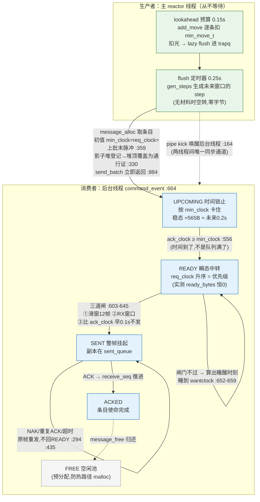

# 2026-11-17｜2-3 serialqueue + 流控背压

## 今日目标

- 2-3：serialqueue 发送队列与流控背压（提前学；1-3 收尾与 1-4 JD 拐角顺延）。
- 重点：step 批量如何出门、堵了谁负责。
- oid 机制 → 挪到 3-1（本篇不覆盖）。

**掌握度总览**（⏳ = 只有结论、机制待深挖，见「下一步」）：

| 块 | 状态 |
| -- | -- |
| 上游半张图：规划→trapq→生成→影子堆→时间闸 | ✅ 已拆到源码级 |
| 链路层：帧格式 / 滑窗+RX窗口 / ACK+RTO 重传 / command_event 主循环 | ✅ 已拆到源码级（见「三」） |
| 实测水位解读（SQ GEN 字段、565 B、M400 泄洪） | ✅ 本篇扩写（见「实测详解」） |

## 一、核心图景

**数据流全景**（源码视角）：

```
Python:  serialhdl.raw_send(cmd, minclock, reqclock)      ← 每条普通命令
         motion_queuing → steppersyncmgr_gen_steps        ← 每批 step
              │  (C: steppersync_flush → serialqueue_send_batch)
              ▼
   ┌─ upcoming 队列 ── min_clock 时间闸：没到点的先压住
   │        │ check_upcoming_queues 按 ack_clock 放行
   │        ▼
   │   ready 队列 ── 按 req_clock 升序 = 优先级
   │        │ check_send_command 三道闸
   │        ▼
   │   build_and_send_command 拼进 64B 帧 → do_write
   │        ▼
   └─ sent_queue ── 等确认（seq/RTO/重传），receive_seq 推进 → 窗口滑动
```

**条目生命周期**（状态机视角，泳道 = 线程）：



**阅读顺序（5 步）**：

1. 绿色泳道：G-code → trapq → step 报文，塞进 B 后**立即返回**，从不等待；
2. 虚线 pipe kick：两线程唯一同步通道，生产者塞完条目才敲一下门；
3. B→C 唯一判据是**时刻**（`ack_clock ≥ min_clock`），不是容量；
4. C→D 三道闸才看容量；C 是瞬态中转，出闸即打包；
5. D 重传走自环（帧已拼好），E→A 虚线是内存闭环。

> 与直觉不同的三点：① 0.1 s 余量在 C→D 的判定里（`:645`），含义是
> 「最多提前 0.1 s 发」；② 重传不回 READY——帧已拼好，重写
> `sent_queue` 里的字节而已；③ serialqueue 对上游不直接反压，
> 背压经 flush 节拍与 lookahead 预算**间接**传导。

## 二、概念详解（问答沉淀）

**① 时钟家族**——所有跨域比较共用换算函数 `clock_from_time(&ce, t)`，
汇率 = clocksync 的 `est_freq`（2-4 主题）：

| 名字 | 域 | 回答的问题 | 产生方式 | 精度 |
| -- | -- | -- | -- | -- |
| `print_time` / `flush_time` | host 秒 | 轨迹/窗口几点开始 | 规划累加 | 精确 |
| `flush_clock` | MCU tick | 本波干到哪为止 | `clock_from_time(flush_time)` | 域换算 |
| `req_clock` | MCU tick | 这条消息想几点出门、排第几 | 每条自带（批起点/调用方传入/哨兵） | 精确 |
| `min_clock` | MCU tick | 我最晚不能早于几点到 | 影子堆槽位释放时刻 | 精确 |
| `ack_clock` | MCU tick | 现在发的话几点能到 | idletime + est_freq | **估计** |

**② 两个 flush，别混**：

| | 规划 flush（`_process_lookahead`） | step flush（flush 定时器） |
| -- | -- | -- |
| 触发 | 0.15 s 预算扣光（**事件**） | 0.25 s 节拍（**时钟**） |
| 输入 | LookAheadQueue 的 move | trapq 的梯形段 |
| 干什么 | 两趟扫描收敛速度链 | itersolve 求根 + 压缩 |
| 输出 | 绝对时间戳梯形段 → trapq | queue_step 批 → UPCOMING |
| 频率 | 随喂料浮动 | 恒定，无材料空转 |

- 0.15 s = 规划攒批**账本**（`junction_flush -= min_move_t`；首条不扣；
  扣穿触发；规划后无条件重置 0.15，队尾不计入）；0.25 s = 插补**心跳**；
- 三速率稳态平衡：**规划跟料走（事件）→ 插补跟钟走（节拍）→
  执行跟钟走（到点响）**，两级缓冲消化一切速率差。

**③ trapq 不是插补**：纯参数表（14 个规划参数）+ 按时间找段；
位置函数在 itersolve 的 `calc_position_cb`（运动学函数指针）。
trapq = 曲谱（IR），itersolve = 读谱求值——两者可独立替换。

**④ min_clock 的一生（两次改写）**：

```
出生    :359(sc)  min_clock = req_clock = 上一批末脉冲
                  （= 本批起点 = 本批槽位的释放时刻，字段复用）
槽位闸  :320(ss)  req_clock > flush_clock → 整批滞留 emitter 队列
登记    :328(ss)  heap_replace(min_clock)：起点登记进影子堆
改写②  :330(ss)  min_clock = 堆顶 next_avail（全局最早槽位释放）
                  req_clock 不动 → 二者分道
时间闸  :556(sq)  ack_clock ≥ min_clock → UPCOMING→READY 放行
```

记忆锚点：改写①= **私事登记**（我的坑几点空），改写②= **公事许可**
（全局最早谁的坑空了，你就几点到）。

**⑤ 影子堆与固件真相**：槽位只在**排队期间**被占用——固件在
**加载 move 时立刻 `move_free`**（`stepper.c:66-78 stepper_load_next`），
执行中的 move 在 `struct stepper` 里不占槽。所以
堆顶 next_avail =「最早开始执行的那条排队 move 的起点」
=「下一个空槽出现的时刻」→ 到货即换坑，MCU 队列永不过载。
堆容量 = `move_count − reserved`（MCU 在 get_config 握手时上报，
homing/trsync 保留槽位扣除，`mcu.py:1087-1091`）。

影子堆是**开环模型**（三个反直觉结论）：

- **ACK 不参与配额释放**——ACK 只推进 receive_seq（链路层）；
  堆只在发送时 `heap_replace` 前移，没有「ACK→pop 影子堆」的回调；
- **影子堆满 ≠ gen_steps 停跑**——0.25 s 节拍照常触发、照常生成，
  槽位闸只是把批**滞留在 emitter 的 msg_queue** 等下一波重试
  （`:320` break），既不拒绝新 qm 也不停机；
- **一个 MCU 一份堆，全轴共享**——`steppersync_flush` 跨全部
  syncemitter 扫描排序（`:310-318`），X/Y/Z/E 的 qm 一起抢同一池配额。
  普通 `raw_send` 命令（加热/风扇/GPIO）不进堆；但走 syncemitter
  的非步进命令注释明说消耗 move queue 空间（`syncemitter_queue_msg`）。

**⑥ 三层队列对照**：host UPCOMING / MCU move 队列 / 影子堆——
**详见 11-18⑥**（对照表 + 容量握手证据链）。

**⑦ req_clock 的三个消费点**：排序（`:485` 取最小者先拼帧）、
发送节拍（`:645-659` 睡醒计算）、BACKGROUND 哨兵改写
（`:634-641` 贴着 0.105 s 未来发）。分辨：
**min_clock 答「可以到了吗」，req_clock 答「何时、何序」**。

**⑧ 三个时钟域，一次相遇**：计划域（精确记账）vs 传输域（唯一估计源
ack_clock，±0.1 s）vs 执行域（照办）——**带数字的完整时间轴见 11-18⑦**。
只在 `:556`/`:645` 两处碰面，误差在域间界面被余量吸收，不在域内累积。

**⑨ 生产者 7 道门从不等待**：限速 → 拐角 → 预算 → lazy 前缀 →
trapq 登记 → 定时器生成 → 槽位闸；唯一可能「少出货」的是换向滤波
（抹对步）和槽位闸（滞留重试），但都是延后而非阻塞。
底气 = 计划期把「何时」全部算死，执行期只剩「照办」。

## 三、READY 之后：发送链路全解（装箱 → SENT → ACK → 重传）

与上游时间闸是彻底解耦的两个世界——**上游比时刻，链路层比序号和字节**。

```
READY(闸门放行)
   → build_and_send_command   装箱 + 封帧 + 登记      (:473-534)
   → do_write                 OS 写线                 (:384-404)
   → sent_queue               副本挂起，等确认
        ├─ ACK 到达 → update_receive_seq  释放记账 + RTT 回归  (:186-246)
        ├─ 重复 ACK → 快速重传            (PR_NOW)             (:294)
        └─ 超时     → retransmit_event    指数退避重发全队列    (:435-468)
```

### 1. 装箱循环（`build_and_send_command :473-534`）

```c
473:    int len = MESSAGE_HEADER_SIZE;          // 从 2B 空头开始
485:    list_for_each_entry(q, &sq->ready_queues, ready.node)
488:        if (m->req_clock < min_clock) …     // 每轮扫所有队列，取 req_clock 最小者
492:        if (len + qm->len > MESSAGE_MAX - MESSAGE_TRAILER_SIZE)
            break;                              // 塞不下就封帧（payload 上限 59B）
497:        memcpy(&buf[len], qm->msg, qm->len);
```

**notify 侧线**（`:503-507`）：需要等响应的命令（`get_response`）`notify_id ≠ 0`，
不释放——`req_clock` **第三次改写**为 `send_seq`，挂进 `notify_queue`；
ACK 推进到该序号时唤醒 Python 侧等待者。普通命令直接 `message_free`。

**封帧四步**（`:517-524`）：长度字节 → `MESSAGE_DEST | (send_seq & 0x0f)`
→ CRC16-CCITT → `SYNC=0x7E`。

**4 位序号不乱的秘密**：接收端用**模差**还原真值——
`rseq_delta = (帧序号 − receive_seq) & 0x0f`（`handle_message:255`）。
真实差值 < 16 时模差精确（=16 会误判为重复 ACK），滑窗 12 = 16 − 4
余量，吸收帧在 OS 缓冲/ACK 在线上的边缘情况。

**出厂登记**（`:525-532`）——字段复用的妙处：

```c
out->receive_time = idletime;   // 预计到达时刻（bittime 累加，ack_clock 同源）
sq->send_seq++;
sq->need_ack_bytes += len;      // RX 窗口闸记账 +=
list_add_tail(&out->node, &sq->sent_queue);
if (sent_queue 空) → retransmit 定时器挂在 idletime + rto   // 超时闹钟只在队头
```

### 2. ACK 到达（`handle_message :248-305` + `update_receive_seq :186-246`）

MCU 每收到一帧回**至少 1 字节空帧**（即 ACK）：

- **累积确认**（同 TCP）：`update_receive_seq` 从 `sent_queue` 队头逐个弹出、
  `need_ack_bytes -= sent->len`（`:194`），弹到确认序号为止。
  `receive_seq=7` 意味着 0-6 全确认——ACK 丢一帧不要紧，后帧序号会补上；
- **弹空关闹钟**（`:216-222`）：sent_queue 空 → `RETRANSMIT=PR_NEVER`；
  否则重设到新队头的 `idletime + rto`；
- **RFC6298 RTT 回归**（`:227-246`）——`srtt/rttvar/rto` 的来源：

```c
delta  = eventtime − sent->receive_time;    // 实际 ACK 时刻 − 预测到货时刻
rttvar = (3·rttvar + |srtt − delta|) / 4;
srtt   = (7·srtt + delta) / 8;              // 经典 EWMA
rto    = srtt + 4·rttvar;  clamp[25ms, 5s]
```

每帧只采一个样本（`rtt_sample_seq`：`:529-530` 打点、`:227` 消费），
重传帧不采样（Karn 思想），避免污染估计；
- **重复 ACK = NAK**（`:291-298`）：1 字节空帧但序号没前进 → MCU 收到了
  后续帧而前面丢了（空洞让回执停在旧序号）→ 快速重传 `PR_NOW`；
  `ignore_nak_seq` 限流（一次重传最多跟一个 NAK，防风暴）。

### 3. 超时重传（`retransmit_event :435-468`）

队头帧的「预测到货 + rto」还没等到 ACK：

```c
438:    tcflush(serial_fd, TCOFLUSH);           // 先冲 OS 写缓冲卡住的半帧！
447:    list_for_each_entry(qm, &sq->sent_queue, node)
448:        memcpy(&buf[buflen], qm->msg, qm->len);   // sent_queue 全部帧原样重拼
459:    sq->rto *= 2.0;  cap 5s                 // 超时触发才指数退避
```

- `tcflush` 先行：超时往往意味着缓冲里还有未出去的半截字节，不清会和
  重传字节交错；
- **整队列重发**而非只发"丢的那帧"：累积确认下无法定位具体丢帧，
  全量重发 + MCU 按序号去重最简单且正确；
- NAK 触发的快速重传走同一函数但**不退避**，只设 `ignore_nak_seq`。

### 4. command_event 主循环（`:664-688`）

pollreactor 盯 2 个 fd（serial + pipe 读端）+ 2 个定时器
（`SQPT_RETRANSMIT` / `SQPT_COMMAND`）。每次醒来：

```
while (闸门放行 && ready_bytes > 0)
    build_and_send_command(...)   // 建一帧
闸门不放行 → 返回睡醒时刻（wantclock，:652-659 算出）
```

ACK 推进 `receive_seq` 时 `PR_NOW` 踢 COMMAND 定时器（`:221`）——
**滑窗动态：发满 12 帧 → 停 → ACK 来 → 补 1 帧，管道恒有 ≤12 帧在途**。

### 5. stats 判读表（真实链路上"死列"复活之后）

| 现象 | 读哪列 | 判断 |
| -- | -- | -- |
| 链路慢但没丢 | `srtt` 上涨、`rto` 平稳 | 正常，波特率决定下限 |
| 间歇丢包 | `bytes_retransmit` 缓增、`rto` 偶尔抬升 | 可容忍 |
| 链路恶化 | `rto` 反复顶到 5s、`retransmit_seq` 频繁 | 该查线了 |
| 完全断连 | `bytes_read` 冻结 + rto 连续退避 | 触发 comms timeout |

## 四、实测详解（`sim/lab/trace-serial.py`，源码零改动）

实验：`backpressure.gcode` —— 600 段 0.5 mm 短 move（F9000，
每段三角曲线 v=27.39 mm/s，共 16.7 s）；`backpressure.cfg` 加 `[statistics]`。
打点：`SerialReader.raw_send`（普通命令）+ `steppersyncmgr_gen_steps` 后抓统计。

### 1. `SQ GEN` 行字段全解

```
SQ GEN #1 flush_time=0.000 bytes_write=132 bytes_read=0 ... send_seq=15
        receive_seq=4294967295 retransmit_seq=0 srtt=0.000 rttvar=0.000
        rto=10000000000000000.0 ready_bytes=0 upcoming_bytes=0
```

| 组 | 字段 | 含义 | 模拟器里 |
| -- | -- | -- | -- |
| 货运量 | `bytes_write` | 累计写给串口的字节（含配置期命令） | **live** |
| | `bytes_read` | MCU 回来的字节 | dead=0（不收） |
| | `bytes_retransmit` / `bytes_invalid` | 重传 / 坏帧字节 | dead=0 |
| 序号 | `send_seq` | 已发帧数（#1 行的 15 帧 = 配置协议，尚无 step） | **live** |
| | `receive_seq` | ACK 推进的确认序号 | **dead=4294967295 即 -1（哨兵）** |
| | `retransmit_seq` | 重传起点 | dead=0 |
| 传输质量 | `srtt` / `rttvar` | 平滑 RTT / 方差回归估计 | dead=0（无样本） |
| | `rto` | 重传超时（1e16 = `PR_NEVER`，永不醒） | **dead（哨兵）** |
| 水位 | `ready_bytes` | 瞬态中转，出闸即打包 | **live，恒 0** |
| | `upcoming_bytes` | 被时间闸压住的未来 step | **live，主看这列** |

判读口诀：**模拟器里只有 `bytes_write` / `send_seq` / `ready_bytes` /
`upcoming_bytes` 四列活着**；`receive_seq=-1`、`rto=1e16` 是
SQT_DEBUGFILE 的哨兵值（`serialqueue.c:737-740`），宣告 ACK/RTO 机制关闭。

### 2. 稳态水位 565 B 的来历

每波 flush 生成 0.25 s 未来运动的 step（约 40 条报文）；
时间闸允许它们"提前躺在 UPCOMING"，但只能提前到各自 `min_clock`
（≈ 脉冲时刻）为止。三速率平衡时：

```
供给节奏 = 消费节奏（都等于打印实时推进速率）
  → 每波新压入的 ≈ 每波被放行的
  → UPCOMING 常驻 ≈ 一个 flush 窗口的量 ≈ 565±3 B ≈ 未来 0.2 s
```

`ready_bytes` 恒 0 的原因：ready 只是闸门到打包之间的**瞬时中转**
（`:617-618` 满足 0.1 s 窗口立刻 `PR_NOW`），从来不当缓存用。

### 3. M400 收尾泄洪（16.683 → 16.933 两行）

| flush_time | send_seq 增量 | bytes_write 增量 | upcoming_bytes |
| -- | -- | -- | -- |
| 0.45 | 1 | 12 | 469 |
| 0.70 | 20 | 1133 | 0 |
| 1.20 → 2.70 | ~11/批 | ~621/批 | 565±3（稳态） |
| 16.683（M400） | 22 | 1216 | **3345** |
| 16.933 | 62 | 3663 | **0** |

- **3345 的来源**：M400 强制整批 flush（lazy=False），lookahead 清空、
  trapq 里剩余轨迹一次生成完——所有还没生成的 step 在这一波全部出笼，
  它们的脉冲时刻分布在"未来整段"，时间闸先压住 → 水位尖峰；
- **3345 → 0**：MCU 时钟推进，`ack_clock` 逐批追上各批的 `min_clock`
  → 到点放行、打包写线。**不是流控失败，是时间闸到点放行**；
- 时间闸只改变**何时发**，不改变**发多少**——泄洪前后总字节数不变。

### 4. 帧统计与压缩对账

解码 wire 日志：4800 条 `queue_step` + 600 条 `set_next_step_dir`
= 734 帧 / 40943 B → **55.8 B/帧、7.4 条命令拼一帧，帧利用率 87%**
（55.8/64）。首条 `queue_step interval=5040825` 与 2-1 首步公式吻合；
稳态 `interval=9128` → `20e6/(9128×80) = 27.39 mm/s` 正是规划层算出的
cruise 速度——**压缩层与规划层数据对上了**。

### 5. 复现

```bash
python3 sim/lab/trace-serial.py
grep -m12 'SQ GEN' sim/lab/backpressure-klippy.log
cd klipper/klippy && python3 parsedump.py ../out/klipper.dict \
  ../../sim/lab/backpressure-serial.log | grep -c queue_step   # 4800
```

## 五、结合代码

| 知识点 | 源码位置 | 掌握 |
| -- | -- | -- |
| upcoming→ready 时间闸 | `klippy/chelper/serialqueue.c:538-576 check_upcoming_queues` | ✅ |
| 三道闸门 + 睡醒计算 | `klippy/chelper/serialqueue.c:594-660 check_send_command` | ✅ |
| req_clock 优先级拼帧 / 帧格式 | `klippy/chelper/serialqueue.c:473-534`；`src/command.h:46-57` | ✅ |
| BACKGROUND 哨兵改写 | `klippy/chelper/serialqueue.c:634-641` | ✅ |
| 写线程主循环 | `klippy/chelper/serialqueue.c:664-688 command_event` | ✅ |
| 上游入口 / pipe 唤醒 | `klippy/chelper/serialqueue.c:884-921`、`:164-167` | ✅ |
| 重传 / RTO | `klippy/chelper/serialqueue.c:107-115`、`:294`、`:435-468` | ✅ |
| debugfile 特例 | `klippy/chelper/serialqueue.c:737-740` | ✅ |
| Python 包装（notify 回执路径） | `klippy/serialhdl.py:259-261,262-271`；`notify_queue :268-281` | ✅ |
| 0.15 s 预算 / 规划 flush | `klippy/toolhead.py:186-193 add_move`、`:269-301`、`:405-407` | ✅ |
| trapq（IR）与位置函数 | `klippy/chelper/trapq.c:99,121`；`itersolve.c:32,72 calc_position_cb` | ✅ |
| step 批 min_clock 初值 | `klippy/chelper/stepcompress.c:353-376 add_move` | ✅ |
| 影子堆 / 槽位闸 / 改写② | `klippy/chelper/steppersync.c:276-292`、`:300-339` | ✅ |
| 固件槽位释放（加载即释放） | `src/stepper.c:66-78 stepper_load_next` | ✅ |
| move_count 握手 / 保留槽位 | `klippy/mcu.py:1045-1047,1087-1091,1151`；`motion_queuing.py:93-100` | ✅ |

## 自测

1. 三道闸各保护什么？哪道在模拟器里失效、为什么？
2. 为什么 `ready_bytes` 恒 0 而 `upcoming_bytes` 稳定在 ~565 B？
3. flush 节拍 0.25 s → 0.5 s，稳态 `upcoming_bytes` 变多少？M400 泄洪量怎么变？
4. 轴运动批的 `min_clock` / `req_clock` 出生时同为「上一批末脉冲」，
   为什么出门时不同？各自被谁消费？
5. `SQ GEN` 行里哪些字段在模拟器里是"死"的？哨兵值各是什么？
6. 4 位序号只有 0-15，为什么不会乱？它与滑窗 12 的关系？
7. 超时重传为什么先 `tcflush` 再**整队列**重发，而不是只发"丢的那帧"？
8. `srtt/rttvar/rto` 回归的输入是什么？为什么每帧只采一个样本？

### 参考答案

1. 12 帧滑窗 → 防丢帧时重传洪泛（在途 ≤768B）；`receive_window` →
   防 MCU UART RX 溢出；时间闸 → 防「step 属于未来、现在发没用还占线」。
   模拟器 debugfile 模式（`:737-740`）`receive_seq=-1` 且 `rto=PR_NEVER`，
   前两道失效。
2. 时间闸在 upcoming→ready 之间（`:556`）；ready 有消息且进入
   0.1 s 窗口就立刻打包（`:617-618`），是瞬态中转；upcoming 常驻
   ≈ 一个 flush 窗口的未来 step（详见实测详解 §2）。
3. 水位 ≈ 翻倍到 ~1100 B；M400 泄洪量同步翻倍，总字节数不变——
   时间闸只改变何时发，不改变发多少。
4. `steppersync_flush:330` 出门前把 min_clock 从「本批槽位释放时刻」
   改写为堆顶 next_avail（全局最早槽位释放），req_clock 保持本批起点。
   min_clock 被 `:556` 时间闸消费（到达许可），req_clock 被 `:485`
   排序与 `:645` 发送节拍消费。
5. 死列：`bytes_read`、`bytes_retransmit`、`bytes_invalid`、
   `receive_seq`（= -1）、`retransmit_seq`、`srtt/rttvar`（=0）、
   `rto`（= 1e16 即 `PR_NEVER`）。活列：`bytes_write`、`send_seq`、
   `ready_bytes`、`upcoming_bytes`（详见实测详解 §1）。
6. 接收端用模差还原真值：`rseq_delta = (帧序号 − receive_seq) & 0x0f`
   （`handle_message:255`）；在途帧数 < 8 时模差无歧义，序号可安全回绕。
   滑窗 12 的上限正是为此留的余量（见三 §1）。
7. 超时常意味着 OS 写缓冲还有半截未出的字节，`tcflush(TCOFLUSH)` 清掉
   才不会与重传字节交错（`:438`）；累积确认下无法定位具体丢帧，
   全量重发 + MCU 按序号去重最简单且正确（`:447-451`）。
8. 输入 = 实际 ACK 时刻 − 该帧出厂时预测的到货时刻
   （`sent->receive_time` 即 idletime 预测，`:229`）；每帧只采一个
   （`rtt_sample_seq`，重传帧不采样——Karn 思想）避免污染估计；
   `rto = srtt + 4·rttvar`，clamp[25ms, 5s]（`:227-246`）。

## 下一步

- 2-3 已收官（READY 之后全链路补齐，见「三」）；可选加深：用
  734 帧真数据逐字节解一帧验证帧格式结论。
- 1-3 收尾：`set_junction`（`toolhead.py:100-114`）三段时长验算。
- 1-4：JD 拐角几何（`R_jd = sin/(1−sin)` 的来历）。
- oid 机制 → 挪 3-1。
- 2-4 预告：`ack_clock` 的汇率 `ce.est_freq` 从哪来、准不准——clocksync 全部内容。
