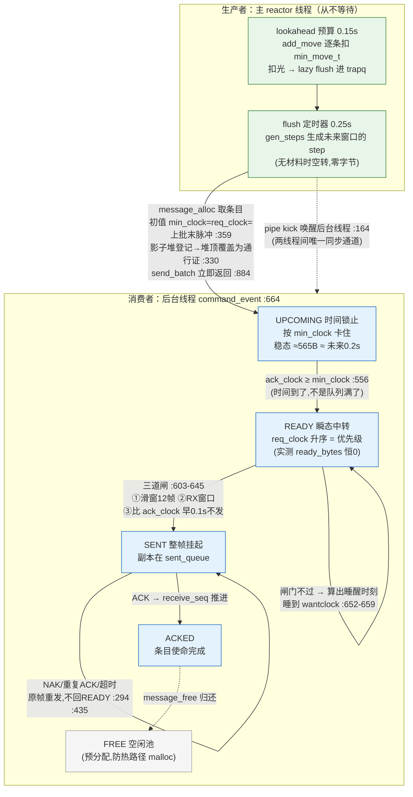

# 2026-11-17｜2-3 serialqueue + 流控背压

## 今日目标

- 2-3：`serialqueue` 发送队列、流控背压、oid 机制（按调整后的优先级提前学习，
  1-3 收尾与 1-4 JD 拐角顺延）。
- 复习衔接：2-1/2-2（插补采样 + 压缩）已掌握，今天的重点是它的下游——
  step 批量如何出门、堵了谁负责、可靠性怎么保证。

## 做了什么

### 知识点

**数据流全景**（先背这张图）：

```
Python:  serialhdl.raw_send(cmd, minclock, reqclock)      ← 每条普通命令
         motion_queuing → steppersyncmgr_gen_steps        ← 每批 step
              │  (C: steppersync_flush → serialqueue_send_batch)
              ▼
   ┌─ upcoming 队列 ── min_clock 时间闸：没到点的先压住
   │        │ check_upcoming_queues 按 ack_clock 放行
   │        ▼
   │   ready 队列 ── 按 req_clock 升序 = 优先级
   │        │ check_send_command 三道闸
   │        ▼
   │   build_and_send_command 拼进 64B 帧 → do_write
   │        ▼
   └─ sent_queue ── 等确认（seq/RTO/重传），receive_seq 推进 → 窗口滑动
```

**条目生命周期**（同一件事的状态机视角，泳道 = 线程）：



**阅读顺序（5 步）**：

1. 绿色泳道（生产者）：G-code → trapq → step 报文，`send_batch` 塞进 B 后**立即返回**，从不等待；
2. 虚线 pipe kick：生产者只在塞完条目时敲一下门，真正的搬运全在蓝色泳道（后台线程）；
3. B→C 的边只有一个判据：**时刻**（`ack_clock ≥ min_clock`），不是容量——满不满不重要，时间到才走；
4. C→D 的三道闸才看容量（12 帧滑窗 / RX 窗口）；C 是瞬态的，出闸即打包；
5. D 的重传走自环（帧已拼好），E→A 的虚线是内存闭环——池子大小决定在途上限。

> 与直觉不同的三点：① 0.1 s 余量在 C→D 的判定里（`:645`），含义是「最多提前
> 0.1 s 发」；② 重传不回 READY——帧已拼好，只把 `sent_queue` 里的字节再写
> 一遍；③ serialqueue 对上游不直接反压，背压经 flush 节拍与 lookahead 预算
> **间接**传导，且所有控制信号都是**时刻**（`min_clock` / `mq_time`），
> 字节数只是观测值（`upcoming_bytes` 无人读取做决策）。

1. **发送是「先压住、到点再放」**：每条消息带 `min_clock` 进 upcoming 队列；
   预计到达 MCU 的时钟 `ack_clock ≥ min_clock` 才挪进 ready。未来的 step 不下发。
2. **三道闸门**（`check_send_command`）：
   - `send_seq − receive_seq ≥ 12`（`MAX_PENDING_BLOCKS`）→ 睡 0.25 s 等确认：
     滑动窗口，在途未确认帧上限 12×64B = 768B；
   - `need_ack_bytes > receive_window` → 等：保护 MCU 的 UART RX 缓冲
     （`RECEIVE_WINDOW` 常量来自 MCU 字典，`serialhdl.py` 下发）；
   - `min_ready_clock ≤ ack_clock + 0.1s×est_freq` 才立刻发，
     否则算出精确的睡醒时刻——req_clock 早于 now+0.1s 才值得发。
3. **优先级 = req_clock 排序**：拼帧时线性扫 ready 队列取 req_clock 最小的一条；
   塞不下就断。紧急的（step、事件）永远先出门。
4. **打包是批帧**：帧 = header 2B + payload ≤ 59B + trailer 3B（crc16+sync），
   `MESSAGE_MAX=64`、4 位序号（`MESSAGE_SEQ_MASK=0x0f`）、`MESSAGE_SYNC=0x7E`；
   多条小命令拼一帧。
5. **serialqueue 对 Python 永不阻塞**：`serialqueue_send` 是 fire-and-forget，
   上游唤醒靠一根 pipe；真正的「上游被堵」不在这里，
   而在 motion_queuing 的 flush 节拍和 toolhead 的 lookahead——
   背压通过「upcoming 水位上涨 → flush 追不上」间接传导。
6. **可靠性内建**：4 位序号 + `sent_queue` + 自适应 RTO
   （`MIN_RTO=25ms`，`srtt/rttvar` 回归），NAK/超时触发重发。
7. **模拟器边界**：批处理 `-o` 模式下 serialqueue 是 `SQT_DEBUGFILE` 类型：
   `receive_seq = -1`、`rto = PR_NEVER`，闸门 1/2 永不触发，只剩时间闸。
8. **可观测性**：`serialqueue_get_stats` 暴露
   `send_seq/receive_seq/ready_bytes/upcoming_bytes/rto`，
   是线上排查「卡顿是否通信瓶颈」的第一个入口。

### 关键概念（时钟家族 / 两个 flush / 三层队列 / min_clock 一生）

**① 时钟家族**——所有跨域比较共用一个换算函数
`clock_from_time(&ce, t)`，汇率 = clocksync 的 `est_freq`（2-4 主题）：

| 名字 | 域 | 回答的问题 | 产生方式 | 精度 |
| -- | -- | -- | -- | -- |
| `print_time` / `flush_time` | host 秒 | 轨迹/窗口几点开始 | 规划累加 | 精确 |
| `flush_clock` | MCU tick | 本波干到哪为止 | `clock_from_time(flush_time)` | 域换算 |
| `req_clock` | MCU tick | 这条消息想几点出门、排第几 | 每条自带（批起点/调用方传入/哨兵） | 精确 |
| `min_clock` | MCU tick | 我最晚不能早于几点到 | 影子堆槽位释放时刻 | 精确 |
| `ack_clock` | MCU tick | 现在发的话几点能到 | idletime + est_freq | **估计** |

**② 两个 flush，别混**：

| | 规划 flush（`_process_lookahead`） | step flush（flush 定时器） |
| -- | -- | -- |
| 触发 | 0.15 s 预算扣光（**事件**） | 0.25 s 节拍（**时钟**） |
| 输入 | LookAheadQueue 的 move | trapq 的梯形段 |
| 干什么 | 两趟扫描收敛速度链 | itersolve 求根 + 压缩 |
| 输出 | 绝对时间戳梯形段 → trapq | queue_step 批 → UPCOMING |
| 频率 | 随喂料浮动 | 恒定，无材料空转 |

- 0.15 s = 规划攒批**账本**（`junction_flush -= min_move_t`；首条不扣；
  扣穿触发；规划后无条件重置 0.15，队尾不计入）；
- 0.25 s = 插补**心跳**；
- 三个速率的稳态平衡：规划跟料走（事件）→ 插补跟钟走（节拍）→
  执行跟钟走（到点响），两级缓冲消化一切速率差。

**③ trapq 不是插补**：纯参数表（14 个规划参数）+ 按时间找段；
位置函数在 itersolve 的 `calc_position_cb`（运动学函数指针）。
trapq = 曲谱（IR），itersolve = 读谱求值——两者可独立替换。

**④ min_clock 的一生（两次改写）**：

```
出生    :359(sc)  min_clock = req_clock = 上一批末脉冲
                  （= 本批起点 = 本批槽位的释放时刻，字段复用）
槽位闸  :320(ss)  req_clock > flush_clock → 整批滞留 emitter 队列
登记    :328(ss)  heap_replace(min_clock)：起点登记进影子堆
改写②  :330(ss)  min_clock = 堆顶 next_avail（全局最早槽位释放）
                  req_clock 不动 → 二者分道
时间闸  :556(sq)  ack_clock ≥ min_clock → UPCOMING→READY 放行
```

记忆锚点：改写①= **私事登记**（我的坑几点空），改写②= **公事许可**
（全局最早谁的坑空了，你就几点到）。

**⑤ 影子堆与固件真相**：槽位只在**排队期间**被占用——固件在
**加载 move 时立刻 `move_free`**（`stepper.c:66-78 stepper_load_next`），
执行中的 move 在 `struct stepper` 里不占槽。所以
堆顶 next_avail =「最早开始执行的那条排队 move 的起点」
=「下一个空槽出现的时刻」→ 到货即换坑，MCU 队列永不过载。
堆容量 = `move_count − reserved`（MCU 在 get_config 握手时上报，
homing/trsync 保留槽位扣除，`mcu.py:1087-1091`）。

**⑤′ 影子堆是开环模型（三个反直觉结论）**：
- **ACK 不参与配额释放**——ACK 只推进 receive_seq（链路层）；
  堆只在发送时 `heap_replace` 前移，没有「ACK→pop 影子堆」的回调；
- **影子堆满 ≠ gen_steps 停跑**——0.25 s 节拍照常触发、照常生成，
  槽位闸只是把批**滞留在 emitter 的 msg_queue** 等下一波重试
  （`:320` break），既不拒绝新 qm 也不停机；
- **一个 MCU 一份堆，全轴共享**——`steppersync_flush` 跨全部
  syncemitter 扫描排序（`:310-318`），X/Y/Z/E 的 qm 一起抢同一池配额。
  普通 `raw_send` 命令（加热/风扇/GPIO）不进堆；
  但走 syncemitter 的非步进命令注释明说消耗 move queue 空间
  （`syncemitter_queue_msg`）。ACK/重传堆积 = 链路层瓶颈；
  upcoming 上涨 = 时间闸/空位推算；两者调试要分开看。

**⑥ 三层队列对照**：host UPCOMING（发货缓冲，时间闸守护）/
MCU move 队列（执行排队，MCU 自守护）/ 影子堆（host 的软件镜像，
纯记账不存报文）。upcoming 是 host 术语，MCU 侧没有对应物。

**⑦ req_clock 的三个消费点**：排序（`:485` 取最小者先拼帧）、
发送节拍（`:645-659` 睡醒计算）、BACKGROUND 哨兵改写
（`:634-641` 贴着 0.105 s 未来发）。分辨：
**min_clock 答「可以到了吗」，req_clock 答「何时、何序」**。

**⑧ 三个时钟域，一次相遇**：计划域（精确记账：print_time / flush_clock /
req_clock / min_clock）vs 传输域（唯一估计源：ack_clock，±0.1 s）vs
执行域（照办）；计划与传输只在 `:556`/`:645` 两处碰面，
0.1 s 余量专门吸收估计误差——误差在域间界面被吸收，不在域内累积。

**⑨ 生产者 7 道门从不等待**：限速 → 拐角 → 预算 → lazy 前缀 →
trapq 登记 → 定时器生成 → 槽位闸；唯一可能「少出货」的是换向滤波
（抹对步）和槽位闸（滞留重试），但都是延后而非阻塞。
底气 = 计划期把「何时」全部算死，执行期只剩「照办」。

### 结合代码

| 知识点 | 源码位置 |
| -- | -- |
| upcoming→ready 时间闸 | `klippy/chelper/serialqueue.c:538-576 check_upcoming_queues` |
| 三道闸门 + 睡醒计算 | `klippy/chelper/serialqueue.c:594-660 check_send_command` |
| req_clock 优先级拼帧 | `klippy/chelper/serialqueue.c:473-534 build_and_send_command` |
| BACKGROUND 哨兵改写 | `klippy/chelper/serialqueue.c:634-641` |
| 写线程主循环 | `klippy/chelper/serialqueue.c:664-688 command_event` |
| 上游入口 / pipe 唤醒 | `klippy/chelper/serialqueue.c:884-921`、`:164-167 kick_bg_thread` |
| 重传 / RTO | `klippy/chelper/serialqueue.c:107-115`、`:435-468` |
| debugfile 特例 | `klippy/chelper/serialqueue.c:737-740` |
| 帧结构常量 | `src/command.h:46-57` |
| Python 包装 | `klippy/serialhdl.py:259-261 raw_send`、`:237-242 stats`、`:115-118 receive_window` |
| 0.15 s 预算 / 规划 flush | `klippy/toolhead.py:186-193 add_move`、`:269-301 _process_lookahead`、`:405-407` |
| trapq（IR）与位置函数 | `klippy/chelper/trapq.c:99,121`；`itersolve.c:32,72 calc_position_cb` |
| step 批 min_clock 初值 | `klippy/chelper/stepcompress.c:353-376 add_move`（= last_step_clock） |
| 影子堆 / 槽位闸 / 改写② | `klippy/chelper/steppersync.c:276-292 heap_replace`、`:300-339 steppersync_flush` |
| 固件槽位释放（加载即释放） | `src/stepper.c:66-78 stepper_load_next` |
| move_count 握手 / 保留槽位 | `klippy/mcu.py:1045-1047,1087-1091,1151`、`motion_queuing.py:93-100` |

### 实测（`sim/lab/trace-serial.py`，源码零改动）

实验：`sim/lab/backpressure.gcode` —— 600 段 0.5 mm 短 move（F9000，
每段三角曲线 v=27.39 mm/s，共 16.7 s）；`sim/lab/backpressure.cfg` 加 `[statistics]`。
打点两处：`SerialReader.raw_send`（普通命令）+ `steppersyncmgr_gen_steps` 后抓统计。

批次节奏与水位（`SQ GEN` 行节选）：

| flush_time | send_seq 增量 | bytes_write 增量 | upcoming_bytes |
| -- | -- | -- | -- |
| 0.45 | 1 | 12 | 469 |
| 0.70 | 20 | 1133 | 0 |
| 1.20 → 2.70 | ~11/批 | ~621/批 | 565±3（稳态） |
| 16.683（M400 收尾） | 22 | 1216 | **3345** |
| 16.933 | 62 | 3663 | **0** |

解码 wire 日志：4800 条 `queue_step` + 600 条 `set_next_step_dir`，
共 734 帧 / 40943 字节 → 平均 55.8 B/帧、约 7.4 条命令拼一帧，帧利用率 87%。

四条结论：

1. **flush 节拍恒定 0.25 s**：每次 flush 生成 0.25 s 未来运动的 step。
2. **稳态 upcoming ≈ 565 B 是「未来缓冲」水位**（≈0.2 s 的未来步）；
   `ready_bytes` 恒 0——ready 是瞬态中转，出闸即打包写线。
3. **M400 收尾泄洪**：upcoming 3345→0、bytes_write +3663；
   不是流控失败，而是时间闸到点放行。
4. **模拟器里 ack 窗口不存在**：`receive_seq=4294967295`（即 -1）、`rto=1e16`。

复现：

```bash
python3 sim/lab/trace-serial.py
grep -m12 'SQ GEN' sim/lab/backpressure-klippy.log
cd klipper/klippy && python3 parsedump.py ../out/klipper.dict \
  ../../sim/lab/backpressure-serial.log | grep -c queue_step   # 4800
```

### 关键发现

1. **背压有两层**：serialqueue 内部的三道闸只决定「何时发」；
   对上游的背压不在 serialqueue（send 永不阻塞 Python），
   而在 motion_queuing 的 flush 节拍——「谁等谁」的答案在层间，
   不在队列本身。时间闸只改变何时发，不改变发多少。
2. **延迟决策的层次**：upcoming（时间闸压住）→ ready（优先级排队）→
   sent（等确认）三级队列各自解决一个问题：时机、次序、可靠性；
   这比单一 FIFO + 阻塞写是结构性的进步，值得照搬。
3. **环境边界本身就是知识点**：批处理 debugfile 模式绕过了滑窗与
   receive_window 两道闸，说明这两道闸保护的是「真实通信链路」；
   换向滤波（0.75 ms）保护的是「执行端物理」——不同闸门对应不同的失效域。

## 自测

1. 三道闸各保护什么？哪道在模拟器里失效、为什么？
2. 为什么实测中 `ready_bytes` 恒 0 而 `upcoming_bytes` 稳定在 ~565 B？
3. 把 flush 节拍从 0.25 s 改成 0.5 s，稳态 `upcoming_bytes` 大约变成多少？
   M400 收尾的泄洪量怎么变？
4. 轴运动批的 `min_clock` 和 `req_clock` 出生时同为「上一批末脉冲」，
   为什么出门时两者不同？各自被谁消费？

### 参考答案

1. 12 帧滑窗 → 防丢帧时重传洪泛（在途上限 768B）；`receive_window` →
   防 MCU UART RX 缓冲溢出；时间闸 → 防「step 属于未来、现在发没用还占线」。
   模拟器是 debugfile 模式（`serialqueue.c:737-740`），`receive_seq=-1` 且
   `rto=PR_NEVER`，前两道失效。
2. 时间闸位于 upcoming→ready 之间（`:556`）；ready 一旦有消息且
   `min_ready_clock ≤ ack_clock+0.1s` 就 `PR_NOW` 立刻打包（`:617-618`），
   所以 ready 只是瞬时中转；upcoming 则长期压着约 0.2 s 的未来 step。
3. 未来缓冲 ≈ flush 节拍内的步数，节拍翻倍 → 水位 ≈ 翻倍到 ~1100 B；
   M400 泄洪量同步翻倍，但总字节数不变。
4. 因为 `steppersync_flush:330` 出门前把 min_clock 从「本批槽位释放时刻」
   改写为堆顶 next_avail（全局最早槽位释放时刻），req_clock 保持本批起点
   不动。min_clock 被 serialqueue 的时间闸消费（`:556` 到达许可），
   req_clock 被拼帧排序（`:485`）与发送节拍（`:645`）消费。

## 下一步

- 1-3 收尾：`set_junction`（`toolhead.py:100-114`）三段时长公式逐项验算，
  顺带看清 `check_move → limit_speed` 改写 `max_cruise_v2` 的触发条件。
- 1-4：JD 拐角几何推导（`R_jd = sin/(1−sin)` 的来历、向心项何时起约束）。
- 2-4 预告：时间闸里的 `ack_clock = clock_from_time(&sq->ce, idletime)`
  依赖 `ce.est_freq`——MCU 时钟频率估计从哪来、准不准，是 clocksync 的全部内容。
